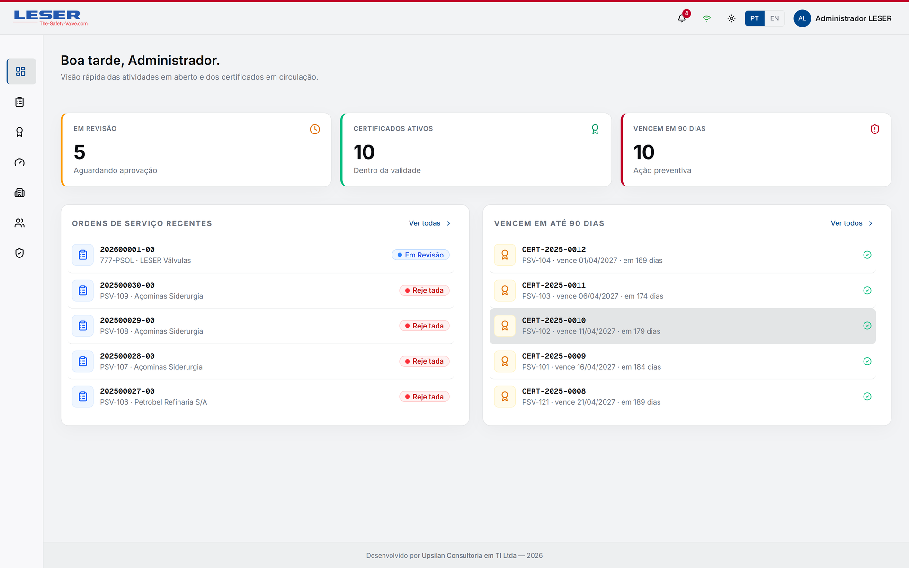
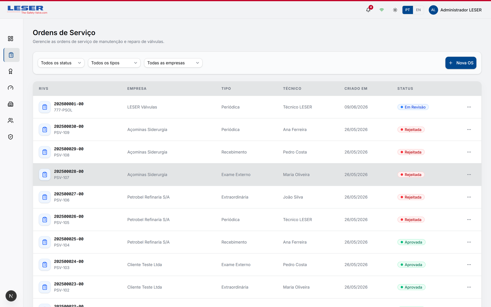
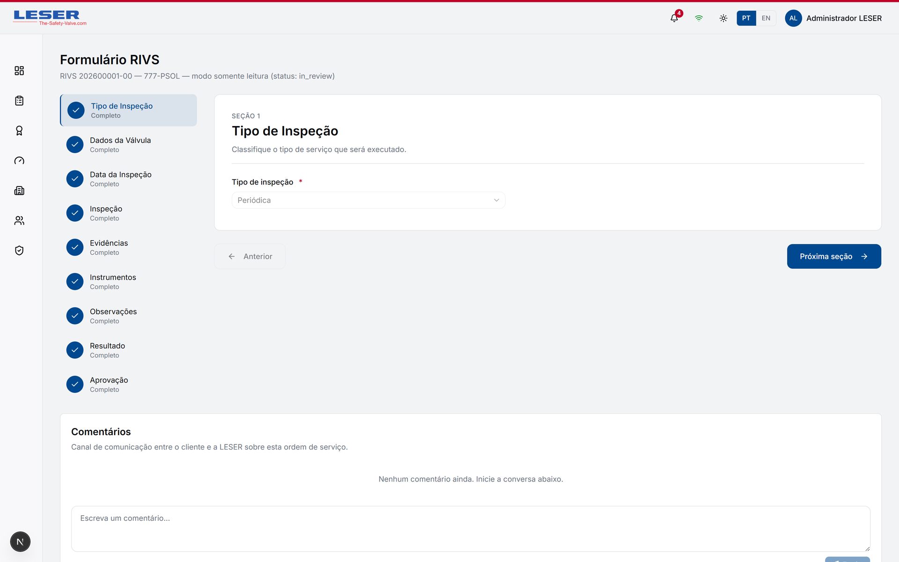
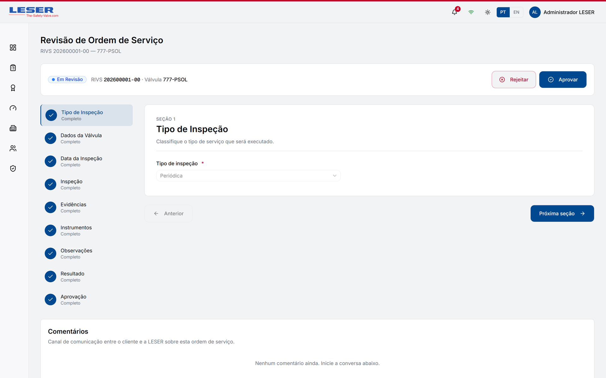
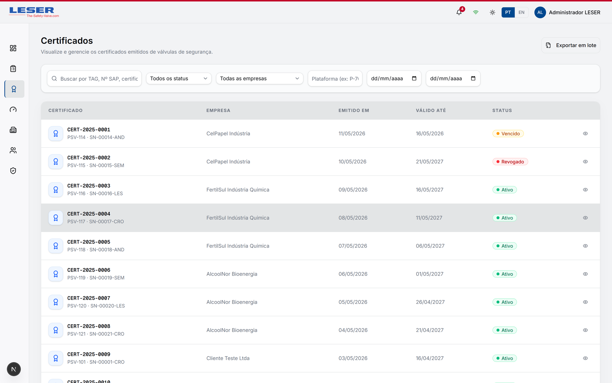
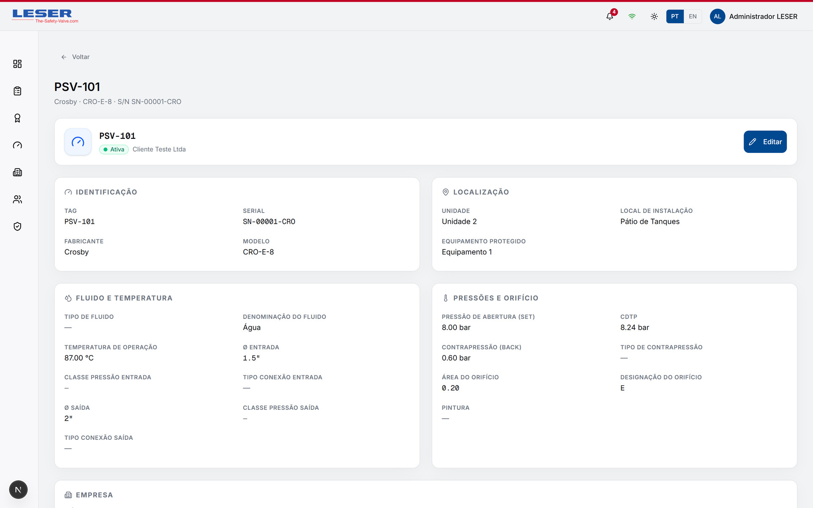
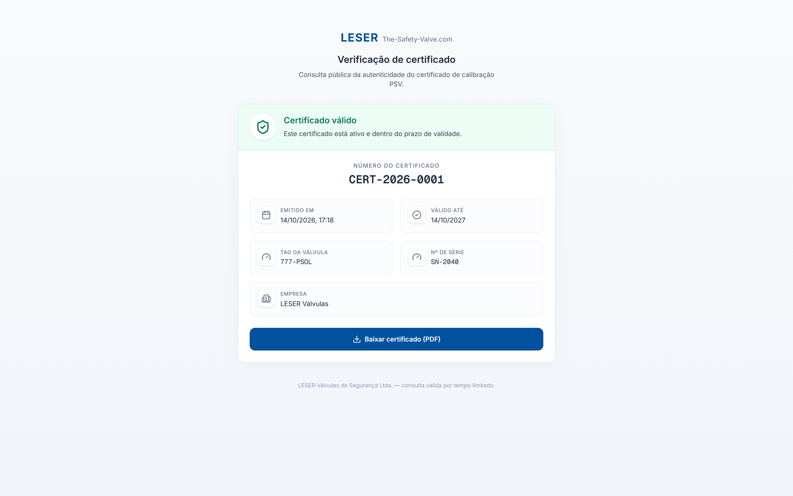
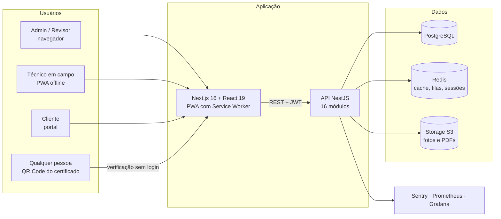

# LESER — Plataforma de Certificação de Válvulas de Segurança (PSV)

**Digitaliza o ciclo de certificação de válvulas de segurança: da ordem de serviço à inspeção em campo, revisão técnica e certificado digital verificável por QR Code.**
Desenvolvida pela Upsilan para a LESER (fabricante de válvulas de segurança), com a Petrobras como cliente final.

---

## Resumo

| | |
|---|---|
| **Problema** | Válvulas de segurança precisam ser calibradas e certificadas periodicamente. O processo era feito em papel e planilhas: retrabalho, pouca rastreabilidade e nenhuma forma de o cliente final confirmar se um certificado é autêntico. |
| **Solução** | Plataforma web que cobre o ciclo inteiro — abertura da ordem de serviço, inspeção técnica em campo (formulário RIVS com evidências, funcionando **offline**), revisão e aprovação, emissão do certificado em PDF e **verificação pública por QR Code assinado**. |
| **Equipe** | Projeto em **equipe de 4 desenvolvedores**: arquiteto, desenvolvedor sênior (code review) e dois desenvolvedores back-end — eu fui um deles, com contribuições também no front-end. |

> **Sobre este repositório** — é a vitrine de um projeto real e proprietário. O **código-fonte não é publicado**;
> aqui estão a visão do produto, a arquitetura, as decisões técnicas (ADRs) e as telas, todas com **dados fictícios**
> de desenvolvimento.

---

## Em números

| Métrica | Valor |
|---|---|
| Módulos do back-end (NestJS) | **16** · **86** endpoints REST |
| Migrations versionadas (TypeORM) | **41** |
| Casos de teste | **~2.380** (≈1.730 back-end · ≈650 front-end) — unitários, integração e E2E |
| Código | **~83 mil linhas** de TypeScript |
| Idiomas da interface | Português e inglês |
| Decisões documentadas | **10 ADRs** — [ver todos](docs/adr/README.md) |

---

## Telas

> Dados fictícios do ambiente de desenvolvimento.

| | |
|---|---|
|  |  |
| **Ordens de serviço** — status do ciclo por válvula e empresa | **Formulário RIVS** — inspeção técnica em seções, com evidências |
|  |  |
| **Revisão** — revisor aprova ou rejeita antes da emissão | **Certificados** — validade, vencimento e revogação |
|  |  |
| **Válvula** — dados técnicos, pressões e localização | **Verificação pública** — aberta pelo QR Code impresso, sem login |

---

## Arquitetura

- **Back-end modular em NestJS**: cada domínio com controller, service, DTOs validados e entidades TypeORM.
- **Autorização por papéis** (admin, revisor, técnico, cliente) com *guards* globais e escopo por empresa.
- **Auditoria declarativa**: o decorator `@Auditable` grava quem alterou o quê, com campos sensíveis removidos.
- **PWA offline-first** para os técnicos, com fila local e sincronização quando a conexão volta.

📄 Diagramas do ciclo de certificação e da sincronização offline em **[docs/architecture.md](docs/architecture.md)**.

---

## Destaques de engenharia

| Desafio | Como foi resolvido | Decisão |
|---|---|---|
| **Inspeção em campo sem internet** | Fila local em IndexedDB, *Background Sync* e nova tentativa com *backoff*. Cada mutação tem um UUID único, então reenviar é seguro; conflitos são detectados por versão (*optimistic locking*) e registrados na auditoria. | [ADR 0008](docs/adr/0008-pwa-service-worker-workbox.md) |
| **Certificado verificável por qualquer pessoa** | QR Code com JWT assinado por chave própria e payload mínimo; o endpoint público tem limite de requisições e sempre consulta o status no banco, então uma revogação vale até para etiquetas já impressas. | [ADR 0007](docs/adr/0007-qr-code-com-jwt-assinado.md) |
| **PDF regulatório confiável** | Gerado no back-end com `@react-pdf/renderer`, sem navegador headless: documento determinístico, com hash SHA-256 de integridade no rodapé e menor consumo de memória. | [ADR 0010](docs/adr/0010-geracao-de-pdf-no-backend.md) |
| **Sessões seguras** | Access + refresh token com rotação, múltiplas sessões por dispositivo e invalidação no Redis ao sair. | [ADR 0003](docs/adr/0003-autenticacao-jwt-access-refresh.md) |
| **Qualidade obrigatória** | Cobertura mínima bloqueante no CI, testes de integração com PostgreSQL e Redis reais e E2E com Playwright (incluindo modo offline). | [ADR 0006](docs/adr/0006-padroes-de-testes.md) |

➡️ Todas as decisões: **[docs/adr](docs/adr/README.md)**.

---

## Meu papel no projeto

Atuei como **desenvolvedor back-end**, com contribuições também no front-end, sob code review do desenvolvedor sênior. Entre as entregas que implementei:

**Back-end (NestJS)**
- **Autenticação e segurança** — login/refresh com rotação de tokens JWT, múltiplas sessões por dispositivo, logout com invalidação no Redis, *guards* de autorização e decorator `@CurrentUser`.
- **Auditoria** — módulo de log de auditoria com diff legível das alterações.
- **Módulos de domínio** — usuários, empresas e o módulo de **tolerâncias** (CDTP + Leak Test), central para a certificação.
- **E-mail transacional** — notificações com templates e internacionalização PT/EN.
- **Versionamento e validação** de registros com controle de concorrência.

**Front-end (Next.js / PWA)**
- **Service Worker** e estratégia offline (Workbox) para uso em campo.
- **Internacionalização** PT/EN da interface (next-intl).
- Formulários técnicos de inspeção (RIVS), captura de evidências com câmera e melhorias de UX.

---

## Stack

| Camada | Tecnologias |
|---|---|
| **Back-end** | Node.js · NestJS · TypeORM · PostgreSQL · Redis · BullMQ · JWT · Storage S3 · `@react-pdf/renderer` |
| **Front-end** | Next.js 16 · React 19 · TypeScript · TailwindCSS 4 · Radix UI / shadcn · React Hook Form + Zod · next-intl · Workbox (PWA) |
| **Testes** | Jest · testes de integração com banco real · Vitest · Playwright (E2E e offline) |
| **Infra e observabilidade** | Docker · GitHub Actions · Sentry · Prometheus · Grafana |

---

## Contato

**Jean Diniz** — Desenvolvedor Full-Stack
[GitHub](https://github.com/JeanDinniz)

Projeto proprietário — todos os direitos reservados. Conteúdo disponibilizado apenas para avaliação.
