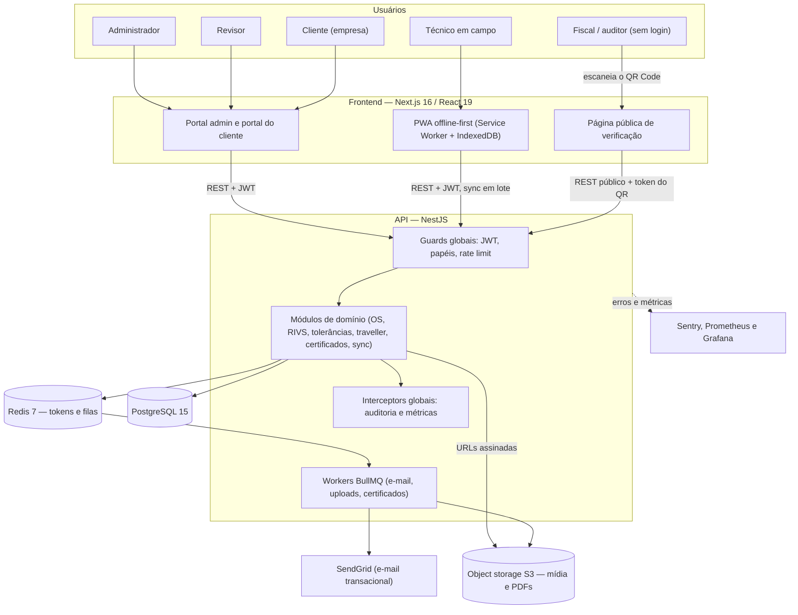
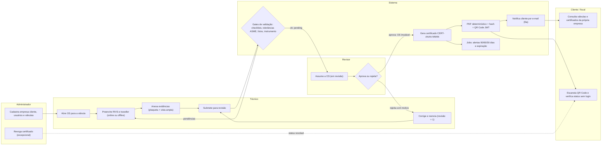
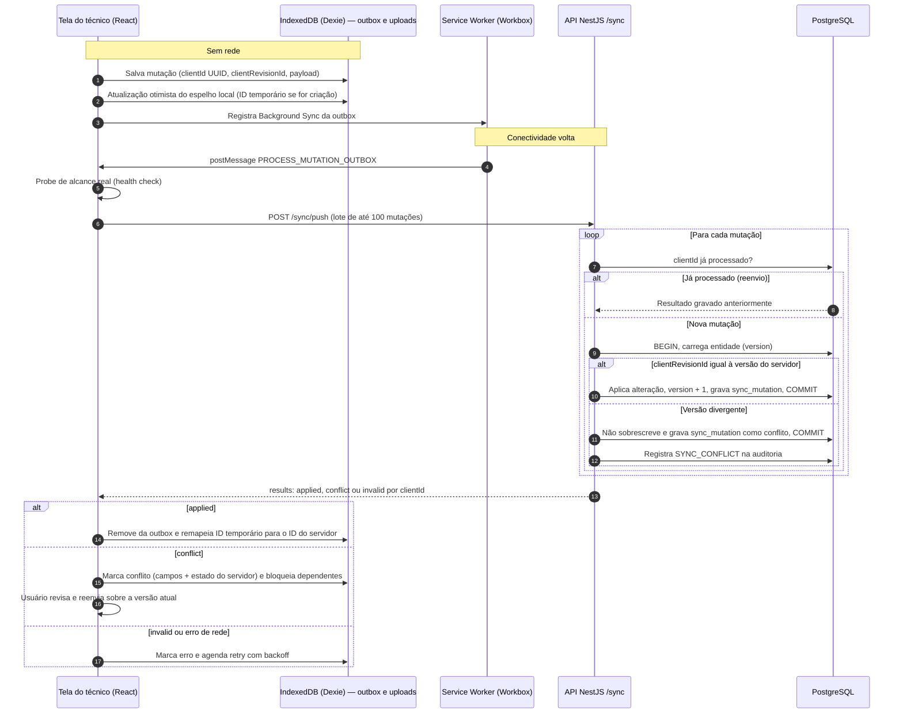

# Arquitetura — LESER, plataforma de certificação de válvulas de segurança (PSV)

> Documento para leitores técnicos. Descreve a arquitetura do sistema desenvolvido pela Upsilan para a LESER, fabricante de válvulas de segurança. O cliente final é a Petrobras. A equipe tinha 4 pessoas: um arquiteto de solução, um dev sênior responsável pelo code review e dois devs back-end, um deles o autor deste portfólio, que também contribuiu no front-end. As decisões estão nos [ADRs](adr/README.md).

---

## 1. Domínio

Válvulas de segurança de pressão (PSV) são equipamentos críticos em plantas industriais e passam por inspeção periódica obrigatória (NR-13, ASME I/VIII). Antes do sistema, o processo dependia de laudos em papel, e-mails e planilhas. O LESER digitaliza o ciclo de ponta a ponta:

1. **Ordem de serviço (OS):** aberta para uma válvula cadastrada. Só pode existir **uma OS ativa por válvula**, regra garantida por um índice único parcial no PostgreSQL.
2. **Inspeção técnica em campo (RIVS):** o técnico preenche o formulário de inspeção (tipo de inspeção, dados da válvula, checklists visuais e de recebimento, teste de pressão de abertura CDTP, teste de estanqueidade, inspeção interna, instrumentos, resultado), anexa evidências fotográficas obrigatórias (plaqueta e vista ampla) e acompanha o **traveller digital** (checklist de etapas do processo). Tudo isso funciona **offline**, no PWA.
3. **Validação automática:** o backend calcula as **tolerâncias de pressão** conforme a norma (ASME VIII como padrão, ASME I com quatro faixas) e a pressão de teste de estanqueidade. Antes de liberar o envio, ele bloqueia a submissão se faltar algum item obrigatório: tipo de inspeção, datas coerentes, checklists, evidências, instrumento com calibração válida ou resultado. CDTP fora da tolerância só passa com justificativa.
4. **Revisão:** um revisor assume a OS, aprova ou rejeita (com motivo obrigatório). Uma OS rejeitada volta a rascunho com a **revisão incrementada**, o que mantém o histórico (o número RIVS carrega o sufixo da revisão).
5. **Certificado:** na aprovação, o sistema gera automaticamente o certificado (`CERT-AAAA-NNNN`, validade de 12 meses), com **PDF determinístico** gerado no backend, hash de integridade e **QR Code com JWT assinado**. Correções geram uma nova revisão do certificado, e a anterior passa a `SUPERSEDED`.
6. **Verificação pública:** qualquer pessoa escaneia o QR Code na válvula e vê o status atual (vigente, expirado ou revogado) sem precisar de login.
7. **Ciclo de validade:** jobs agendados expiram certificados vencidos e enviam alertas de vencimento **90, 60 e 30 dias** antes.

### Máquinas de estado

| Entidade | Estados |
| --- | --- |
| Ordem de serviço | `draft → pending → in_review → approved` / `in_review → rejected → draft` (revisão + 1) |
| Certificado | `active`, `expired`, `revoked`, `superseded` |

Uma OS **aprovada é imutável**. Qualquer tentativa de alteração é recusada na camada de serviço.

### Papéis

| Papel | Pode |
| --- | --- |
| **Administrador** | Tudo: usuários, empresas clientes, auditoria, revogação de certificados |
| **Revisor** | Assumir, aprovar e rejeitar OS; gerar certificados |
| **Técnico** | Criar e preencher OS/RIVS, anexar evidências, executar o traveller (inclusive offline) |
| **Cliente** | Consultar, somente leitura, as válvulas e os certificados **da própria empresa** |

---

## 2. Componentes

| Componente | Tecnologia | Responsabilidade |
| --- | --- | --- |
| **Frontend / PWA** | Next.js 16, React 19, TypeScript, Tailwind + shadcn/ui, next-intl, Dexie (IndexedDB), Workbox | Portal admin e portal do cliente; PWA offline-first para técnicos; página pública de verificação |
| **API** | NestJS 10, TypeORM, class-validator / Zod, Swagger/OpenAPI | Regras de negócio, autenticação/autorização, auditoria, sincronização offline |
| **Banco relacional** | PostgreSQL 15 | Dados de domínio; migrations versionadas (`synchronize` desligado) |
| **Redis 7** | ioredis + BullMQ | Refresh tokens com TTL; filas assíncronas (e-mail, processamento de uploads, jobs de certificados) |
| **Object storage** | S3 (produção) / compatível com S3 (dev/staging) | Fotos, vídeos e PDFs; acesso apenas por URL assinada temporária |
| **E-mail** | SendGrid + templates Handlebars, via fila | Boas-vindas, recuperação de acesso, OS aprovada/rejeitada, certificado publicado, alertas de vencimento |
| **Observabilidade** | Sentry (API e web), Prometheus + Grafana, exporters | Erros com scrubbing de dados pessoais; latência por rota; profundidade das filas; uptime; memória e containers |
| **CI/CD** | GitHub Actions + Docker | Lint, testes, contrato OpenAPI, build, E2E e deploy por ambiente com gate manual em produção |

### Módulos do backend

`auth` · `users` · `companies` · `valves` · `service-orders` (com comentários e notas internas) · `tolerances` · `traveller` · `certificates` (PDF, jobs de expiração e alertas) · `certificate-recipients` · `uploads` · `storage` · `audit` · `mail` · `sync` · `catalog-config` · `metrics`

### (a) Contexto e containers

---

## 3. Fluxo do ciclo de certificação

---

## 4. PWA offline-first e sincronização

Os técnicos trabalham em plantas industriais com conectividade instável. Por isso, o frontend é um PWA que **funciona sem rede** e sincroniza quando a conexão volta.

**No cliente:**

- **Service Worker** (Workbox `injectManifest`, [ADR 0008](adr/0008-pwa-service-worker-workbox.md)): pré-cache, estratégias por tipo de rota, página `/offline`, atualização de versão controlada pelo usuário e handler de **Background Sync**. Autenticação e mutações nunca entram no cache.
- **IndexedDB (Dexie)**, com schema versionado e regras de upgrade: um espelho local de OS, válvulas e certificados (hidratado por `GET /sync/snapshot` numa transação atômica), rascunhos de RIVS com autosave, uma **fila de uploads** (blobs de foto) e uma **outbox de mutações**. No logout, o banco local inteiro é apagado.
- **Detecção real de conectividade**, com um probe ao health check em vez de confiar em `navigator.onLine`, que mente em redes Wi-Fi com portal cativo.
- **IDs temporários:** entidades criadas offline recebem um ID local, que é remapeado para o ID do servidor quando a mutação é aplicada.
- **Retry com backoff exponencial** e limite de tentativas. Itens que dependem de uma mutação rejeitada ou em conflito ficam bloqueados, para não gerar órfãos.

**No servidor (`/sync`):**

- `GET /sync/snapshot` devolve uma janela de dados do usuário (30 dias por padrão, 90 no máximo) com **ETag**. Quando nada mudou, a resposta é `304 Not Modified`.
- `POST /sync/push` recebe até 100 mutações por lote (`create`/`update` de OS, válvula ou etapa do traveller), cada uma validada por um schema Zod próprio do handler e aplicada **em transação**.
- **Idempotência por `clientId`:** cada mutação tem um UUID gerado no cliente, com constraint única no banco. Se uma mutação for reenviada, o servidor devolve o resultado já gravado. Uma corrida entre dois workers é tratada capturando a violação de unicidade e lendo o resultado vencedor.
- **Controle de concorrência otimista:** a OS tem `@VersionColumn` (TypeORM). Toda mutação `update` precisa trazer o `clientRevisionId` que o cliente viu por último. Se ele divergir da revisão atual, o servidor **não sobrescreve**: devolve `conflict` com a lista de campos conflitantes e o estado do servidor. A política é conservadora (*servidor vence*), adequada a um domínio de certificação.
- Todo conflito é registrado na auditoria como `SYNC_CONFLICT` e pode ser consultado em `GET /sync/conflicts`. Nas edições online, o mesmo `@VersionColumn` faz a API responder **409 Conflict** quando outro usuário alterou a OS antes.

### (c) Sequência da sincronização offline

---

## 5. Segurança e autorização

- **Guards globais** registrados no módulo raiz, nesta ordem: `JwtAuthGuard` (toda rota exige JWT, exceto as marcadas com `@Public()`), `RolesGuard` (lê o metadado de `@Roles(...)` do handler ou da classe e responde 403 quando o papel não confere) e `ThrottlerGuard` (rate limiting global, com limites mais rígidos no login e nas rotas públicas de certificado).
- **Autorização em duas camadas:** o papel é checado no guard, e o **escopo de dados** na camada de serviço. Um usuário `client` só enxerga válvulas, OS, certificados e uploads da própria empresa. No frontend, um `RoleGuard` por rota e controles condicionais ao papel funcionam como defesa em camadas, mas a autoridade final é sempre o backend.
- **Tokens:** access token de 15 min e refresh token de 7 dias no Redis, por usuário e sessão ([ADR 0003](adr/0003-autenticacao-jwt-access-refresh.md)). Os tokens também são emitidos como cookies `httpOnly`, e o cookie de refresh fica restrito ao caminho de refresh.
- **Verificação pública:** JWT dedicado no QR Code, com payload mínimo e chave de assinatura própria ([ADR 0007](adr/0007-qr-code-com-jwt-assinado.md)).
- **Mídia:** nunca pública; o acesso é feito por URL assinada temporária ([ADR 0004](adr/0004-storage-de-midia-s3.md)).
- **Hardening:** `helmet`, validação global de DTOs (class-validator e Zod), validadores de CNPJ e de força de credencial, hash com bcrypt, checklist OWASP Top 10 revisado pela equipe e auditoria de dependências no CI.

## 6. Auditoria

A trilha de auditoria é **declarativa**. Basta anotar um handler com `@Auditable({ action, entityType })`, e um **interceptor global** (`AuditInterceptor`) registra a operação depois que ela termina com sucesso:

- a ação é inferida do verbo HTTP (POST → CREATE, PUT/PATCH → UPDATE, DELETE → DELETE) ou declarada explicitamente (por exemplo, DOWNLOAD do PDF);
- o registro guarda usuário, entidade, ID, corpo da requisição **sanitizado** (campos sensíveis substituídos por `[REDACTED]`), IP e user-agent;
- a gravação é *best effort* e não derruba a requisição se falhar;
- a tabela de auditoria é append-only: não há UPDATE nem DELETE.

Conflitos de sincronização também entram na auditoria, com o estado do servidor e os campos em conflito.

## 7. Controle de concorrência e integridade

| Mecanismo | Onde | Protege contra |
| --- | --- | --- |
| `@VersionColumn` (optimistic locking) | Ordem de serviço | Duas edições simultâneas sobrescrevendo uma à outra (409 online, `conflict` no sync) |
| Índice único parcial | OS ativa por válvula | Duas inspeções abertas para a mesma válvula, mesmo sob concorrência |
| Constraint única + idempotência | `clientId` das mutações de sync | Reprocessamento de reenvios e corridas entre workers |
| Constraint única composta | Número de série + fabricante da válvula | Cadastro duplicado da mesma válvula física |
| Imutabilidade por estado | OS aprovada, certificado | Alteração de registros que já embasaram um certificado |
| Hash SHA-256 no PDF | Certificado | Adulteração do documento entregue |

## 8. Storage

O módulo `storage` abstrai um cliente S3 (AWS SDK v3) e gera URLs assinadas com expiração. O mesmo código atende a AWS S3 em produção e um storage compatível com S3 em dev/staging; só a configuração muda. No upload, o serviço valida o tipo real do arquivo pela assinatura binária (*magic bytes*), sem confiar na extensão. O processamento pesado fica numa fila BullMQ, onde o processador extrai metadados e gera miniaturas de imagem (sharp) e de vídeo (ffmpeg).

## 9. Internacionalização (i18n)

- **Frontend:** `next-intl`, com mensagens separadas por domínio (auth, certificados, OS, válvulas, auditoria etc.) em **pt-BR** e **en-US**. O idioma é resolvido por cookie, com fallback para o idioma padrão.
- **Backend:** o usuário tem uma preferência de idioma (`pt-BR` / `en-US`), usada, por exemplo, nas comunicações por e-mail.

## 10. Observabilidade

- **Sentry** na API (NestJS) e no web (Next.js), com upload de source maps no build e um **filtro de dados pessoais** que remove headers sensíveis, chaves como credenciais, tokens e documentos, e mascara JWTs, Bearer tokens e e-mails em qualquer string. A lógica é a mesma no backend e no frontend.
- **Prometheus + Grafana:** um interceptor global de métricas HTTP (latência p50/p95/p99 por rota, taxa de requisições e de erros), um coletor de **profundidade das filas BullMQ**, métricas de heap e exporters de Redis, blackbox (uptime e expiração de certificado TLS), cAdvisor e node exporter. O endpoint de métricas é bloqueado no proxy público.
- **Runbooks** de deploy, rollback, rotação de chaves e incidentes, incluindo um runbook específico para OOM.

## 11. Testes

| Nível | Ferramenta | Escopo |
| --- | --- | --- |
| Unitário (backend) | Jest + factories | Services, guards, pipes, validadores, interceptors, processadores de fila, handlers de sync |
| Integração (backend) | Jest + PostgreSQL e Redis reais (containers no CI) | Repositórios, transações, sync push/snapshot, tolerâncias, certificados, e-mail |
| E2E de API | Jest + supertest | Autenticação, autorização e validação ponta a ponta via HTTP |
| Unitário (frontend) | Vitest + Testing Library + fake-indexeddb | Camada offline (outbox, fila de uploads, bootstrap, reachability), componentes e schemas |
| E2E de UI | **Playwright** (Chromium, Firefox, WebKit) | Jornadas de autenticação, OS, certificados, válvulas, clientes, usuários e jornada do cliente |
| E2E PWA/offline | Playwright (projeto dedicado) | Service Worker, comportamento offline e sincronização |

Cobertura global mínima de **80%** (statements, branches, functions e lines), bloqueante no CI ([ADR 0006](adr/0006-padroes-de-testes.md)).

## 12. CI/CD

- **Pull request:** lint e checagem de formatação (backend e frontend), typecheck do frontend, **verificação do snapshot OpenAPI** (o contrato da API não muda sem querer), testes unitários com gate de cobertura, testes de integração com PostgreSQL e Redis de serviço e migrations aplicadas, **smoke de runtime** (build + migrations + boot) e auditoria de dependências.
- **E2E:** workflows separados para smoke E2E com Playwright e para PWA/offline, com API e frontend buildados e banco com seed.
- **Deploy:** imagens Docker publicadas pelo CI. O merge na branch principal faz deploy automático em staging/homologação. A **produção** tem uma branch própria e **gate de aprovação manual** no ambiente do GitHub. Há também notificação automática de falha de deploy.
- **Processo:** branch por tarefa vinculada a uma issue, PR obrigatório, revisão do dev sênior antes do merge, e ninguém faz merge do próprio PR.
